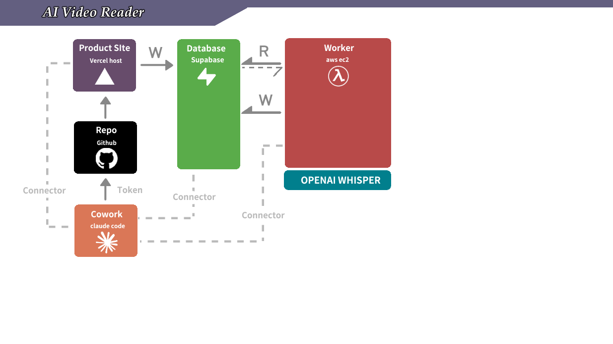

# M1 Prerequisites — OpenAI + AWS EC2 (SSM-only)

## What this skill does

Adds two accounts on top of M0's three (GitHub / Supabase / Vercel) and provisions one Ubuntu EC2 instance that runs the worker for the rest of M1. **No SSH. No key pair. No PEM file. No IAM access key. Everything goes through MCP** — Supabase MCP for DB writes, **AWS MCP** (`aws___run_script`, which runs Python `call_boto3(...)`) for IAM / EC2 / Secrets Manager / SSM, and AWS Systems Manager (SSM) for in-instance commands.

| # | Service | Used for |
|---|---|---|
| 5 | **OpenAI** | Whisper transcription (`whisper-1`) |
| 6 | **AWS** | One EC2 instance + IAM instance profile for SSM |

By the end of this skill the student has:

1. An OpenAI API key (`sk-...`) with at least \$5 of credit.
2. An AWS account with **AWS MCP** connected in Cowork (OAuth sign-in, Section 2.0).
3. One running `t3.small` Ubuntu 22.04 EC2 instance, tagged `Name=m1-worker`, with an IAM instance profile that grants SSM Run Command.
4. `ffmpeg`, `python3.12`, `python3.12-venv`, `git` installed on the EC2 via SSM `SendCommand` (no SSH).
5. The M0 GitHub repo cloned to `/home/ubuntu/app` on the EC2.
6. A Python venv pre-created at `/home/ubuntu/app/worker/venv` ready for the M1 worker to install requirements into.

**No port 22 is open. There is no SSH key.** Everything you do on the EC2 from now on goes through SSM `SendCommand` (via `aws___run_script`).

## How M1 will deploy code to this EC2 (preview)



*Cowork (Claude Code) is the orchestrator — Token-authenticated git push to GitHub, plus connector / MCP links to Vercel, Supabase, and the EC2 you provision in this skill. Vercel-hosted Next.js writes to Supabase; the EC2 reads pending jobs, runs OpenAI Whisper, writes transcripts back.*

This prereq builds the EC2; the **main M1 skill** writes the worker code and starts deploying to it. So you (or the student) understands what infrastructure to optimize for: the deploy model is **GitHub-pull + systemd**, no Docker, no CI, no SSH.

- The M1 worker code lives in the **same GitHub repo as the M0 web app** — under a new `worker/` subdirectory the main skill creates in Step 5. (Vercel auto-deploys `app/` as before; it ignores `worker/`.)
- Code reaches the EC2 by `git pull` *into* `/home/ubuntu/app` (which §2.7 below cloned). The pull is triggered through SSM `SendCommand` from Cowork — no `scp`, no `ssh`, no PEM file.
- The distributor process runs as a **systemd service** (`m1-distributor.service`) installed by the main skill in Step 6. systemd handles auto-start on EC2 reboot + auto-restart on crash. Updates: pull → `pip install` → `systemctl restart m1-distributor.service`. All three steps go through SSM `SendCommand`.

That means the EC2 you build here just needs: SSM agent reachable (handled by §2.2 IAM role), `git` + Python venv (handled by §2.6/§2.7), and read access to the four secrets in Secrets Manager (handled by §2.3). Nothing else. The main skill never has to install Docker, configure a CI runner, or open inbound ports.

## Required MCPs (read this first)

This skill assumes you have:

- ✅ **Supabase MCP** (`mcp__supabase_remote__*`) — already installed for M0.
- ✅ **AWS MCP** (official AWS-hosted MCP server, tools such as `aws___run_script`, `aws___get_presigned_url`, `aws___search_documentation`) — added as a custom connector and signed in with OAuth in **Section 2.0** below (you need an AWS account first — Section 2.1).

> **Do not keep the old "AWS API MCP" connector enabled.** It is a different server (tools `call_aws` / `suggest_aws_commands`) that authenticates with an access key. If it is installed, disable it in Customize → Connectors so Claude doesn't mix the two. Nothing in this skill uses it.

If AWS MCP isn't connected: pause this skill, finish Section 2.0, then resume. The whole point of this path is to keep the student out of the AWS console and the terminal — without AWS MCP, you're stuck doing AWS-console clicks manually.

> **Why no SSH?** SSH on EC2 is fine when you have a laptop + a `.pem` file + a stable IP. In Cowork there's no laptop filesystem to hold the PEM, and the network egress story is fiddly. AWS Systems Manager (SSM) gives us a better answer: the EC2 attaches to SSM via an IAM role; we send commands from Cowork via SSM `SendCommand`. No inbound port. No key. Everything audited in CloudTrail. This is the same pattern the production worker in this repo uses (see `feedback_ec2_commands.md`).

## How AWS commands are written in this skill

AWS MCP's `aws___run_script` tool runs a short **Python script** in a sandbox. Inside it you call AWS APIs with:

```python
await call_boto3(service_name="<service>", operation_name="<PascalCaseOperation>", region_name="<region>", params={...})
```

Rules the snippets below follow (keep them if you edit them):

- `operation_name` is the **PascalCase API operation** (`CreateRole`, `SendCommand`) — not the CLI spelling (`create-role`) and not the snake_case boto3 method.
- Pass `region_name` explicitly on every regional service call (EC2, SSM, Secrets Manager). IAM is global and takes no region. Never rely on a default region.
- JSON policy documents go in as **strings** (`json.dumps(...)`).
- End the script with `result = {...}` then `result` on its own line, so the tool returns it.
- Scripts must discover what they need themselves (instance ID, AMI ID) — don't assume variables survive between `aws___run_script` calls.

You never type these yourself: tell Claude what you want ("create the worker role"), and Claude writes and runs the script. The snippets are the canonical recipe.

## Section 1 — OpenAI API key

1. Go to https://platform.openai.com/, sign up (or log in).
2. **Settings → Billing → Add payment method**, add a card.
3. **Add to credit balance** → top up at least **\$5**.
4. **Settings → Limits** → set a **soft monthly cap** (e.g. \$10). This is your runaway-worker insurance.
5. **API keys → Create new secret key**. Copy the `sk-...` value — OpenAI only shows it once.

Hold onto this `sk-...`. We'll inject it into the EC2 via AWS Secrets Manager in Section 2.3.

## Section 2 — AWS account + EC2 (all via MCP)

### 2.1 — AWS account + region

Sign up at https://aws.amazon.com/ if needed. Pick **one region** and stick with it for the whole course (we recommend `us-west-2`, `ap-northeast-1`, or `ap-southeast-1` for latency). Every snippet below has a `REGION = "..."` line — set it to the region you pick here. If you already stored the OpenAI / Supabase secrets before running this skill (see 2.3), use the region where they live (`ListSecrets` shows it) and build everything else in that same region. (The AWS MCP endpoint itself lives in `us-east-1`; that does **not** decide where your EC2 is created — `region_name` does.)

### 2.0 — Connect AWS MCP to Cowork (OAuth, no access key)

> Prerequisite: complete Section 2.1 above (AWS account + region pick), then come back here. Numbered 2.0 — not 2.2 — so this is the FIRST thing you do before any AWS call in Sections 2.2+.

AWS MCP signs you in through your browser (OAuth) — there is **no IAM user to create, no access key, and no `~/.aws/credentials` file**.

1. In Cowork: **Customize → Connectors**.
2. If **AWS API MCP** is installed, **disable** it.
3. **Add → AWS MCP**, using this server URL:
   `https://aws-mcp.us-east-1.api.aws/mcp?oauth=initialize`
4. Click through: **Continue → Add → Connect → Continue**. Wait for **Connecting…**
5. **Sign into new session** — a browser window opens. Sign in to your AWS account as the **Root user** (the email + password you signed up with).
6. When Cowork shows **Needs approval**, choose **Always allow**.

**Check it works** — ask Claude:

> How many IAM users do I have now on my aws account?

Claude should answer with a number (0 is a normal answer on a fresh account). If Claude says the AWS tool isn't available or the sign-in expired, redo steps 4–6.

Nothing else to do for credentials at the end of the course: there's no key to delete. If you want to cut access, remove the AWS MCP connector in Customize → Connectors.

### 2.2 — Create the IAM instance profile

The EC2 needs an IAM role that grants:
- `AmazonSSMManagedInstanceCore` (the managed policy that gives SSM agent permission to phone home — that's how Cowork will run shell commands on the EC2 in 2.6 + 2.7 without SSH)
- Read on the four Secrets Manager secrets we'll create in 2.3 (`openai-api-key`, `supabase-url`, `supabase-secret-key`, `supabase-publishable-key`) — added in Section 2.3 below as a separate inline policy on this same role

Ask Claude to run this with `aws___run_script`:

```python
import json

trust = {
    "Version": "2012-10-17",
    "Statement": [{
        "Effect": "Allow",
        "Principal": {"Service": "ec2.amazonaws.com"},
        "Action": "sts:AssumeRole",
    }],
}

await call_boto3(service_name="iam", operation_name="CreateRole",
                 params={"RoleName": "m1-worker-role",
                         "AssumeRolePolicyDocument": json.dumps(trust)})
await call_boto3(service_name="iam", operation_name="AttachRolePolicy",
                 params={"RoleName": "m1-worker-role",
                         "PolicyArn": "arn:aws:iam::aws:policy/AmazonSSMManagedInstanceCore"})
await call_boto3(service_name="iam", operation_name="CreateInstanceProfile",
                 params={"InstanceProfileName": "m1-worker-profile"})
await call_boto3(service_name="iam", operation_name="AddRoleToInstanceProfile",
                 params={"InstanceProfileName": "m1-worker-profile",
                         "RoleName": "m1-worker-role"})

profile = await call_boto3(service_name="iam", operation_name="GetInstanceProfile",
                           params={"InstanceProfileName": "m1-worker-profile"})
result = {"profile": "m1-worker-profile",
          "roles": [r["RoleName"] for r in profile["InstanceProfile"]["Roles"]]}
result
```

**Verify:** the returned `roles` list contains `m1-worker-role`.

> If `CreateRole` fails with `EntityAlreadyExists`, a previous run already created it — skip that call and continue with the next ones (or ask Claude to check what already exists first).

### 2.3 — Store OpenAI + Supabase secrets in AWS Secrets Manager

#### Why the EC2 needs three secrets, not one

The M1 architecture has two writers to Supabase:

```
[User browser] ──submit─▶ [Vercel: Next.js]  ──W: insert job row──▶ [Supabase]
                                                                       ▲    │
                                                              R: poll  │    │ W: write transcript back
                                                              pending  │    ▼
                                                                   [AWS EC2 worker]  ──▶ [OpenAI Whisper]
```

- **Vercel** writes new `jobs` rows when a user submits the form. It already reads its own Supabase env vars (set in M1 main skill Step 4) — nothing new for Vercel here.
- **The EC2 worker** does *both* reads and writes against Supabase: it polls `jobs` for pending rows, claims one, runs Whisper, then writes the transcript back to `job_sessions`. So the EC2 needs the Supabase URL + **Secret key** (`sb_secret_...`) at runtime — not the Publishable key (`sb_publishable_...`). The Publishable key is RLS-gated and would return zero rows when the worker queries `select * from jobs where status='pending'` (no user session = nothing visible). The Secret key bypasses RLS so the worker can see and update jobs across all users.

Cowork having a Supabase MCP doesn't help the EC2 — that connector is how *Cowork* talks to Supabase, not how the EC2 does. The EC2 is a separate Python process with no MCP, just `boto3` + `supabase-py`. We give it Supabase access by storing the credentials in AWS Secrets Manager and granting the EC2's IAM role permission to read them.

OpenAI is the third secret — the worker calls Whisper directly with that key.

#### How the secret values flow from your eyes into Secrets Manager

You paste each value into the Cowork chat as part of your prompt to Claude. Claude puts it in an `aws___run_script` call that creates the secret. The value flows: your message → Cowork → AWS MCP → AWS Secrets Manager (encrypted at rest with KMS). Once stored, you don't need the plaintext value again — only the EC2 reads it.

> **Chat-retention caveat:** the raw `sk-...` / `sb_secret_...` value briefly appears in your Cowork chat transcript on its way to Secrets Manager. Cowork retains chat history; assume the value is recoverable from your account history for as long as that conversation is retained. This is acceptable for course-grade keys (the OpenAI cap is small, the Supabase secret key is scoped to a learning project), but you should still **rotate both keys at end of course** (revoke the OpenAI key in OpenAI dashboard → Settings → API Keys; rotate the Supabase secret key in Supabase dashboard → Project Settings → API Keys → roll). For a real production deployment you'd type the values into AWS Console → Secrets Manager via your browser, never through the chat — out of scope for this course.

#### Tell Claude

> 「請把這四個 secret 存到 AWS Secrets Manager：
>   - `openai-api-key` = `<paste your sk-... here>`
>   - `supabase-url` = `https://<your-ref>.supabase.co`
>   - `supabase-secret-key` = `<paste your Supabase Secret key — `sb_secret_...` — from Supabase dashboard → Project Settings → API Keys. This is the RLS-bypass key the EC2 worker uses.>`
>   - `supabase-publishable-key` = `<paste your Supabase Publishable key — `sb_publishable_...` — from the same page. RLS-gated, browser-safe.>`」

> **Why store both Supabase keys?** The M1 EC2 worker only reads the **Secret key** (it needs to bypass RLS to see all users' pending jobs). The **Publishable key** is stored alongside it as a convenience: future milestones may want to give the EC2 an RLS-respecting client (e.g. when the worker acts on behalf of a specific user), and having both in one place means students don't have to re-fetch from the Supabase dashboard later. M1 itself doesn't read it.

**Check first.** Many students store these four secrets in a separate step *before* running this skill. Claude runs the `ListSecrets` check (same script as **Verify** below) first and only creates the ones that are **missing**. An existing secret is never overwritten unless you paste a new value for it.

For the missing ones, Claude creates them in one script (updating in place only when you supplied a replacement value):

```python
REGION = "us-west-2"   # the region you picked in 2.1

secrets = {
    "openai-api-key": "<sk-...>",
    "supabase-url": "https://<ref>.supabase.co",
    "supabase-secret-key": "<sb_secret_...>",
    "supabase-publishable-key": "<sb_publishable_...>",
}

out = {}
for name, value in secrets.items():
    try:
        await call_boto3(service_name="secretsmanager", operation_name="CreateSecret",
                         region_name=REGION,
                         params={"Name": name, "SecretString": value})
        out[name] = "created"
    except ClientError as e:
        if e.response["Error"]["Code"] == "ResourceExistsException":
            await call_boto3(service_name="secretsmanager", operation_name="PutSecretValue",
                             region_name=REGION,
                             params={"SecretId": name, "SecretString": value})
            out[name] = "updated"
        else:
            raise

result = out
result
```

Then add the IAM permission to read these to the worker role:

```python
import json

policy = {
    "Version": "2012-10-17",
    "Statement": [{
        "Effect": "Allow",
        "Action": "secretsmanager:GetSecretValue",
        "Resource": [
            "arn:aws:secretsmanager:*:*:secret:openai-api-key-*",
            "arn:aws:secretsmanager:*:*:secret:supabase-url-*",
            "arn:aws:secretsmanager:*:*:secret:supabase-secret-key-*",
            "arn:aws:secretsmanager:*:*:secret:supabase-publishable-key-*",
        ],
    }],
}

await call_boto3(service_name="iam", operation_name="PutRolePolicy",
                 params={"RoleName": "m1-worker-role",
                         "PolicyName": "m1-secrets-read",
                         "PolicyDocument": json.dumps(policy)})
result = {"policy": "m1-secrets-read attached to m1-worker-role"}
result
```

> The `-*` suffix on each ARN matches Secrets Manager's auto-appended random suffix (e.g. `openai-api-key-AbCdEf`). It scopes the role to *exactly* these four secret names without granting `secretsmanager:GetSecretValue *`.

> **Why Secrets Manager (not Parameter Store)?** Both encrypt at rest with KMS, both can be scoped via IAM. Secrets Manager is the AWS-native home for application credentials — it has rotation hooks, audit-logging built in, and a more obvious name for "this is a secret." Parameter Store works fine for non-secret config; we use Secrets Manager here because the OpenAI key + Supabase keys are unambiguously credentials.

**Verify:** list the secrets and check all four names are present (don't read the `SecretString` values unless you're debugging — they're plaintext at that point):

```python
REGION = "us-west-2"
wanted = {"openai-api-key", "supabase-url", "supabase-secret-key", "supabase-publishable-key"}
resp = await call_boto3(service_name="secretsmanager", operation_name="ListSecrets",
                        region_name=REGION)
found = sorted(s["Name"] for s in resp["SecretList"] if s["Name"] in wanted)
result = {"found": found, "missing": sorted(wanted - set(found))}
result
```

### 2.4 — Create a minimal security group

No inbound rules at all. SSM is fully outbound — the EC2 phones home to SSM endpoints over HTTPS (443).

```python
REGION = "us-west-2"
sg = await call_boto3(service_name="ec2", operation_name="CreateSecurityGroup",
                      region_name=REGION,
                      params={"GroupName": "m1-worker-sg",
                              "Description": "M1 worker - outbound only, SSM-managed"})
result = {"group_id": sg["GroupId"]}
result
```

Note the returned `GroupId` (looks like `sg-0abc...`). Default outbound (allow all) is fine — no inbound edits needed.

### 2.5 — Launch the EC2

The script looks up the latest Canonical-published Ubuntu 22.04 AMI for your region, then launches the instance:

```python
REGION = "us-west-2"
SG_ID = "<sg-0abc... from 2.4>"

ami = await call_boto3(
    service_name="ssm", operation_name="GetParameter", region_name=REGION,
    params={"Name": "/aws/service/canonical/ubuntu/server/22.04/stable/current/amd64/hvm/ebs-gp2/ami-id"})
ami_id = ami["Parameter"]["Value"]

run = await call_boto3(
    service_name="ec2", operation_name="RunInstances", region_name=REGION,
    params={
        "ImageId": ami_id,
        "InstanceType": "t3.small",
        "MinCount": 1,
        "MaxCount": 1,
        "IamInstanceProfile": {"Name": "m1-worker-profile"},
        "SecurityGroupIds": [SG_ID],
        "BlockDeviceMappings": [{"DeviceName": "/dev/sda1",
                                 "Ebs": {"VolumeSize": 20, "VolumeType": "gp3"}}],
        "TagSpecifications": [{"ResourceType": "instance",
                               "Tags": [{"Key": "Name", "Value": "m1-worker"}]}],
    })
result = {"instance_id": run["Instances"][0]["InstanceId"], "ami_id": ami_id}
result
```

> A brand-new instance profile can take ~10–20 seconds to become usable. If `RunInstances` fails with `Invalid IAM Instance Profile name`, wait a moment and run it again.

**Wait for SSM to register the instance** (usually 1–2 min after launch):

```python
REGION = "us-west-2"
info = await call_boto3(
    service_name="ssm", operation_name="DescribeInstanceInformation", region_name=REGION,
    params={"Filters": [{"Key": "tag:Name", "Values": ["m1-worker"]}]})
result = [{"instance_id": i["InstanceId"], "ping_status": i["PingStatus"]}
          for i in info["InstanceInformationList"]]
result
```

When the instance appears with `ping_status = "Online"`, it's ready for `SendCommand`. If it never appears, the IAM instance profile is the most likely culprit — confirm `m1-worker-profile` is attached by running `DescribeInstances` (filter `tag:Name = m1-worker`) and checking `IamInstanceProfile` on the instance.

### 2.6 — Install ffmpeg / Python / git via SSM (no SSH)

This script finds the instance, sends the install commands through SSM Run Command, waits for them to finish, and returns the output:

```python
REGION = "us-west-2"

async def run_on_ec2(instance_id, commands, comment):
    sent = await call_boto3(
        service_name="ssm", operation_name="SendCommand", region_name=REGION,
        params={"InstanceIds": [instance_id],
                "DocumentName": "AWS-RunShellScript",
                "Comment": comment,
                "Parameters": {"commands": commands}})
    command_id = sent["Command"]["CommandId"]
    for _ in range(60):                       # up to ~5 min
        await asyncio.sleep(5)
        inv = await call_boto3(
            service_name="ssm", operation_name="GetCommandInvocation", region_name=REGION,
            params={"CommandId": command_id, "InstanceId": instance_id})
        if inv["Status"] not in ("Pending", "InProgress", "Delayed"):
            return {"status": inv["Status"],
                    "stdout": inv["StandardOutputContent"],
                    "stderr": inv["StandardErrorContent"]}
    return {"status": "StillRunning", "command_id": command_id}

desc = await call_boto3(
    service_name="ec2", operation_name="DescribeInstances", region_name=REGION,
    params={"Filters": [{"Name": "tag:Name", "Values": ["m1-worker"]},
                        {"Name": "instance-state-name", "Values": ["running"]}]})
instance_id = desc["Reservations"][0]["Instances"][0]["InstanceId"]

result = await run_on_ec2(
    instance_id,
    ["sudo apt-get update",
     "sudo apt-get install -y python3.12 python3.12-venv python3-pip ffmpeg git",
     "ffmpeg -version | head -1",
     "python3.12 --version"],
    "M1: install ffmpeg, python3.12, git")
result
```

You should see `ffmpeg version ...` and `Python 3.12.x` at the end of `stdout`. If apt errors, retry — Ubuntu's apt sometimes needs a moment after first boot.

> If the script returns `StillRunning`, the command is fine — it just outlasted the wait. Ask Claude to check it with `GetCommandInvocation` using the returned `command_id`.

### 2.7 — Clone the M0 repo + create the venv

Same shape — reuse the `run_on_ec2` helper and instance lookup from 2.6 (each `aws___run_script` call is self-contained, so Claude includes them again), then send:

```python
result = await run_on_ec2(
    instance_id,
    ["sudo -u ubuntu bash -c \"cd /home/ubuntu && git clone https://github.com/<student-username>/<repo-name>.git app\"",
     "sudo -u ubuntu bash -c \"mkdir -p /home/ubuntu/app/worker && cd /home/ubuntu/app/worker && python3.12 -m venv venv && ./venv/bin/pip install --upgrade pip\"",
     "ls /home/ubuntu/app",
     "ls /home/ubuntu/app/worker/venv/bin/python"],
    "M1: clone repo + create venv")
result
```

Replace `<student-username>/<repo-name>` with the GitHub repo URL from M0. If the repo is private, the student needs a deploy key or a personal-access-token clone URL — pause and walk through that, then retry.

## Verify (one-shot)

The end-of-prereq health check, all via MCP, no SSH. One script runs all three checks (include the `run_on_ec2` helper from 2.6):

```python
REGION = "us-west-2"
wanted = {"openai-api-key", "supabase-url", "supabase-secret-key", "supabase-publishable-key"}

# 1. EC2 is running + SSM-managed
info = await call_boto3(
    service_name="ssm", operation_name="DescribeInstanceInformation", region_name=REGION,
    params={"Filters": [{"Key": "tag:Name", "Values": ["m1-worker"]}]})
ssm_rows = [{"instance_id": i["InstanceId"], "ping_status": i["PingStatus"]}
            for i in info["InstanceInformationList"]]
# Expect: one row, ping_status == "Online"

# 2. ffmpeg + python + venv installed
instance_id = ssm_rows[0]["instance_id"]
tools = await run_on_ec2(
    instance_id,
    ["ffmpeg -version | head -1 && python3.12 --version && ls /home/ubuntu/app/worker/venv/bin/python"],
    "M1: verify tools")

# 3. Secrets in AWS Secrets Manager
resp = await call_boto3(service_name="secretsmanager", operation_name="ListSecrets",
                        region_name=REGION)
found = sorted(s["Name"] for s in resp["SecretList"] if s["Name"] in wanted)
# Expect: all four names present

result = {"ssm": ssm_rows, "tools": tools, "secrets_found": found,
          "secrets_missing": sorted(wanted - set(found))}
result
```

If everything looks good, you're ready for the M1 main skill.

## Cost reminder

`t3.small` always-on ≈ **\$15/month** (us-west-2 on-demand as of writing). EBS 20 GiB gp3 ≈ \$1.60/mo whether the instance is running or stopped.

**Stop the EC2 when not actively running an M1 lecture** — ask Claude "stop the m1-worker EC2". It finds the instance by its `Name=m1-worker` tag and calls `ec2 StopInstances`:

```python
REGION = "us-west-2"
desc = await call_boto3(
    service_name="ec2", operation_name="DescribeInstances", region_name=REGION,
    params={"Filters": [{"Name": "tag:Name", "Values": ["m1-worker"]},
                        {"Name": "instance-state-name", "Values": ["running"]}]})
instance_id = desc["Reservations"][0]["Instances"][0]["InstanceId"]
await call_boto3(service_name="ec2", operation_name="StopInstances", region_name=REGION,
                 params={"InstanceIds": [instance_id]})
result = {"stopping": instance_id}
result
```

To resume, ask "start the m1-worker EC2" — same script with `StartInstances`, filtering on `instance-state-name = stopped`.

A **stopped** instance pays ~\$0 for compute (EBS only). The instance ID stays the same, so the same SSM `SendCommand` workflow keeps working.

> **No Elastic IP needed.** SSM doesn't care about the instance's public IP — it talks to AWS endpoints via the SSM agent. Skip the EIP cost entirely.

## CLI-mode variant (if the student isn't in Cowork)

The same operations exist in the `aws` CLI — `call_boto3(service_name="iam", operation_name="CreateRole", ...)` is `aws iam create-role ...`, and so on. In CLI mode the student authenticates the `aws` CLI their own way (`aws sso login` or `aws configure`); in Cowork mode there is nothing to configure beyond the AWS MCP sign-in in Section 2.0.

The **SSH/PEM/EC2-console path is intentionally NOT documented** in this skill. SSM is the only access pattern. If a student insists on SSH (or their org disallows SSM), they'll need a different M1 prereq variant — not in scope here.

## When done

Tell the student:

> 「M1 環境準備完成 — OpenAI key 設好了、EC2 跑著、SSM 可以送指令進去、ffmpeg/python/git 都裝好、repo 也 clone 了。整個過程不需要 SSH、不需要 PEM、不需要打開 terminal。可以開始 M1 主流程 — 跟我說『啟動 M1』。」

## Why this exists as its own skill

- **Reusability:** M2 Stripe + M3 Domain + M4 Serverless all assume the same AWS account + the same SSM access pattern. M3 also reuses the IAM role for Route 53; M4 reuses the AWS account for Lambda + Fargate.
- **Recoverability:** if the EC2 gets terminated or the secrets rotate, the student re-runs this skill instead of re-reading all of M1.
- **Smaller M1 main skill:** the main walkthrough stays focused on schema + worker code + web upload + service management, not "how do I touch AWS at all."
